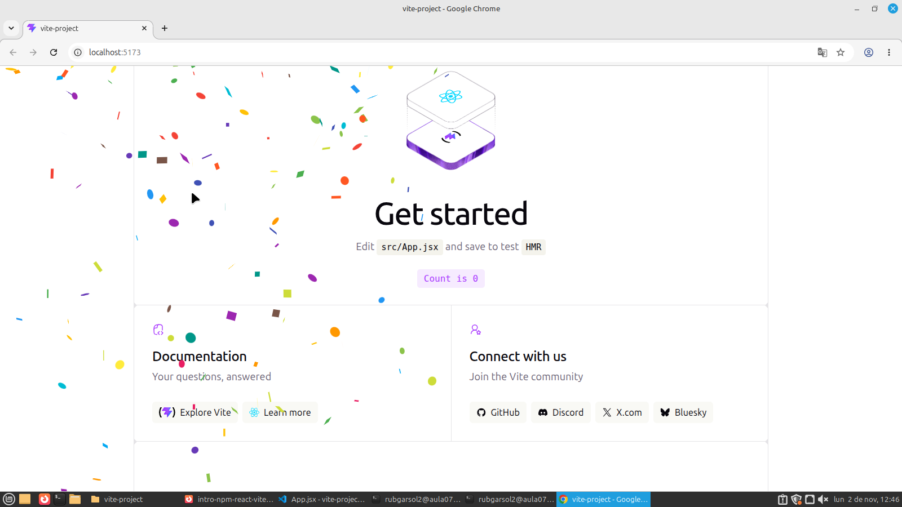
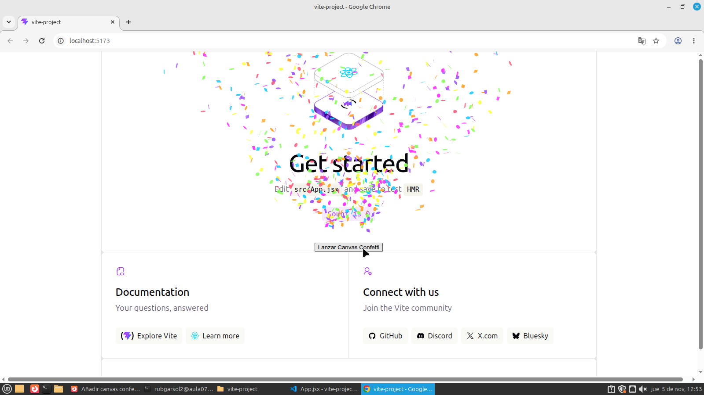
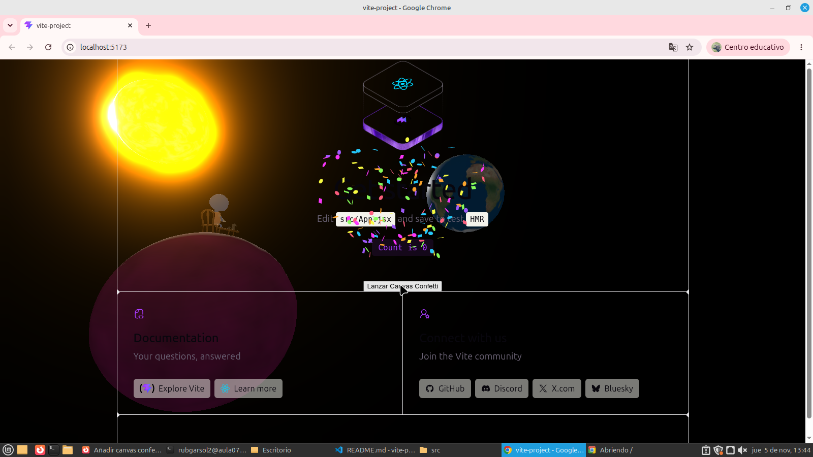

# Proyecto Vite + React

## Descripción

Proyecto realizado con Vite y React para practicar la instalación de dependencias, el uso de componentes y el trabajo con ramas en Git.

Durante el proyecto se han probado tres componentes: React Confetti, Canvas Confetti y una escena 3D utilizando Three.js.

## Ramas del proyecto

- `master`: rama principal.
- `react-confetti`: implementación de React Confetti.
- `canvas-confetti`: implementación de Canvas Confetti.
- `three`: implementación de la escena 3D con Three.js.

## Capturas del proyecto

### 1. React Confetti

### 2. Canvas Confetti

### 3. Escena 3D con Three.js

## Pregunta teórica

**Si la carpeta `node_modules/` está excluida, ¿borrar una dependencia hace alguna acción sobre el repositorio? ¿Cuál?**

Sí. Aunque `node_modules/` esté excluida del repositorio, al eliminar una dependencia se modifican los archivos `package.json` y `package-lock.json`.

Estos cambios sí se guardan en Git mediante un commit. Así, el repositorio refleja que esa dependencia ya no forma parte del proyecto.

## Web desplegada

Pendiente de despliegue.

## Repositorio de GitHub

https://github.com/Rubengarsol/intro-npm-react-vite
